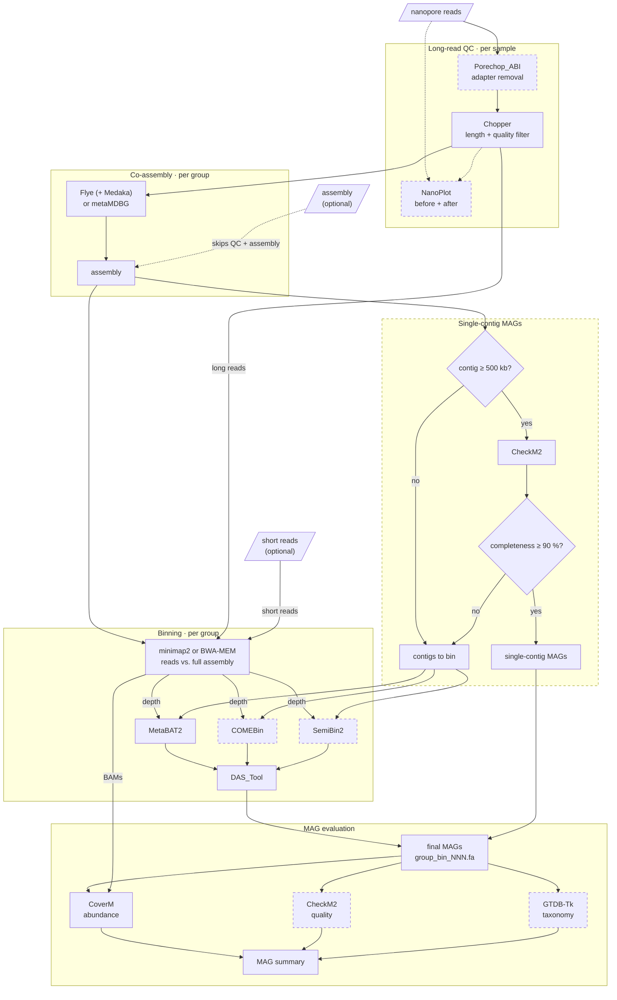

[](https://www.nextflow.io/)
[](https://github.com/nf-core/tools/releases/tag/4.1.0)
[](https://docs.conda.io/en/latest/)
[](https://www.docker.com/)
[](https://sylabs.io/docs/)

```
                                         _
 _ __ ___   __ _  __ _        ___  _ __ | |_
| '_ ` _ \ / _` |/ _` |_____ / _ \| '_ \| __|
| | | | | | (_| | (_| |_____| (_) | | | | |_
|_| |_| |_|\__,_|\__, |      \___/|_| |_|\__|
                 |___/

Long reads-first metagenome assembly and binning
with support for short reads

     Github: https://github.com/dsamoht/mag-ont
     Version: v1.5.2
```

## workflow




## tl;dr
```bash
nextflow run dsamoht/mag-ont --help # nextflow pulls the repo automatically
```

## software dependencies

- Nextflow
- a container engine (i.e. docker/singularity) or conda

## database

- [GTDB-Tk database - release 226](https://ecogenomics.github.io/GTDBTk/installing/index.html#gtdb-tk-reference-data)

## documentation

Full documentation: [usage](./docs/usage.md).  
Pipeline outputs: [output](./docs/output.md).

## acknowledgement

This pipeline is inspired by [**nf-core/mag**](https://github.com/nf-core/mag) and [**HiFi-MAG-Pipeline by PacificBiosciences**](https://github.com/PacificBiosciences/pb-metagenomics-tools/tree/master/HiFi-MAG-Pipeline)
